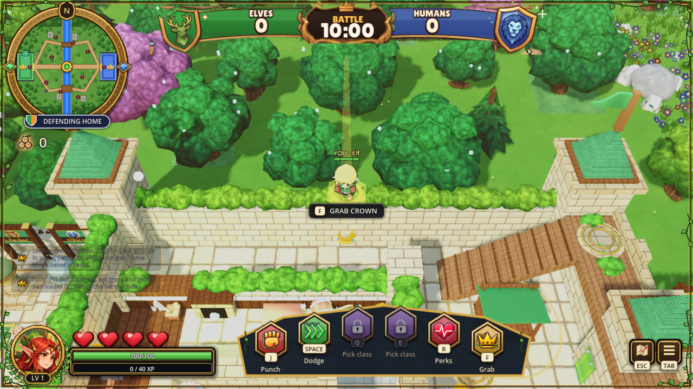
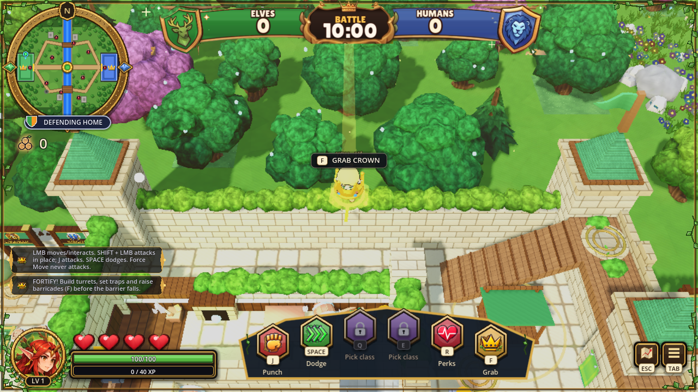
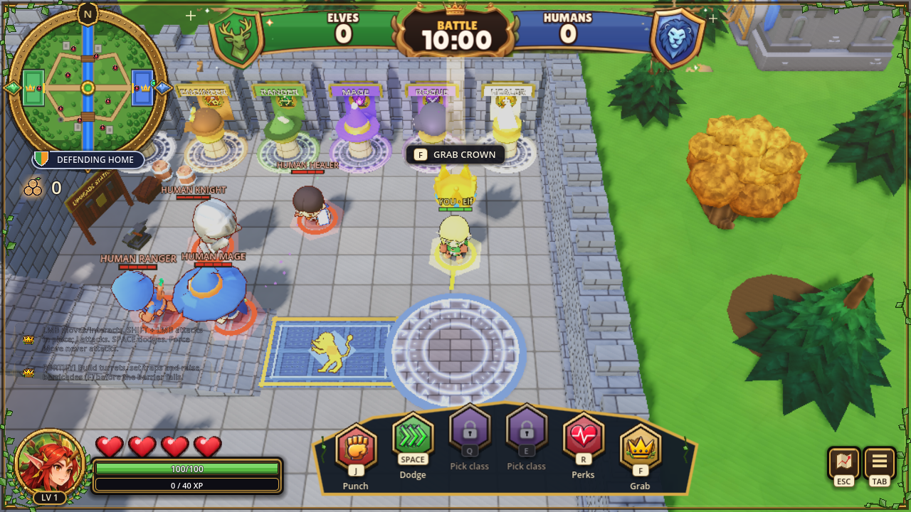
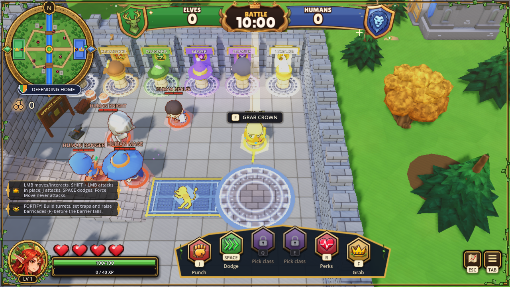

# Crown drop uses the carrier's floor

Agent: Codex-faisal3. Fix for issue #138. Baseline main `0158a9c`.

`Monarch.drop_at` used y=0 for every drop. This places crowns below ramparts
and above sunken cellars. The fix retains the carrier's full position and
uses all three dimensions for the existing floating return to home.
Only `scripts/monarch.gd` changes in production.

## Runtime comparison

| Case | Before | After |
| --- | --- | --- |
| Rampart | Crown y=0; carrier floor y=3.6, crown below wall walkway | Crown y=3.6 beside carrier |
| Human cellar | Crown y=0; carrier floor y=-2.4, crown above carrier | Crown y=-2.4 beside carrier |
| Above home | Horizontal-only check immediately treats it as home | Crown approaches home in 3D at its existing speed |

| Rampart before | Rampart after |
| --- | --- |
|  |  |

| Cellar before | Cellar after |
| --- | --- |
|  |  |

The same fixture, seed, map, viewport, camera and graphics preset produce both
sides. Captures stage the real drop handler at fixed playable-floor positions;
they do not claim a manual match. Time-based idle poses and particles differ.
See [look.md](look.md). All saves are disposable under `C:/Temp`.

## Validation

- Clean official Godot 4.3 headless import, exit 0, no script/import errors.
- `tools/codex3_crown_drop_test.gd`: original source has 4 failures; candidate
  has 0, in the native Compatibility render. Candidate headless run also has
  0 failures. Covers rampart/cellar positions, 3D homing speed, exact home
  arrival, vertical-only return and ordinary ground return.
- Combat self-test: 0 failures; complete seeded candidate bot match recorded
  in `logs/bot-match.log` with RESULT/STAT records.
- Raw logs, raw captures and hashes are retained here. Compatibility logs
  include the existing SSAO/SSIL backend warnings; this is not Forward+
  performance or physical-controller qualification.

Run with `tools/tests/isolated.sh --headless --path . --fixed-fps 60 --script
tools/codex3_crown_drop_test.gd -- --play --gfx=0 --seed=7`. For native captures,
omit `--headless`, use Compatibility and 1280x720, and set
`CROWNS_CROWN_EVIDENCE` to an output directory. On Windows, give each invocation
fresh APPDATA/LOCALAPPDATA under a marked CROWNS_TEST_USER_BASE; the test refuses
a real user-data directory.

No release signoff, Steamworks action or publishing. Owner/lead PR files and
the Ember Pass economy decision remain outside this fix.
