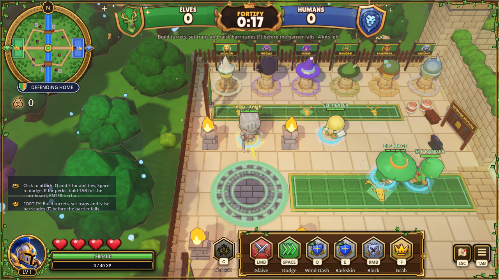
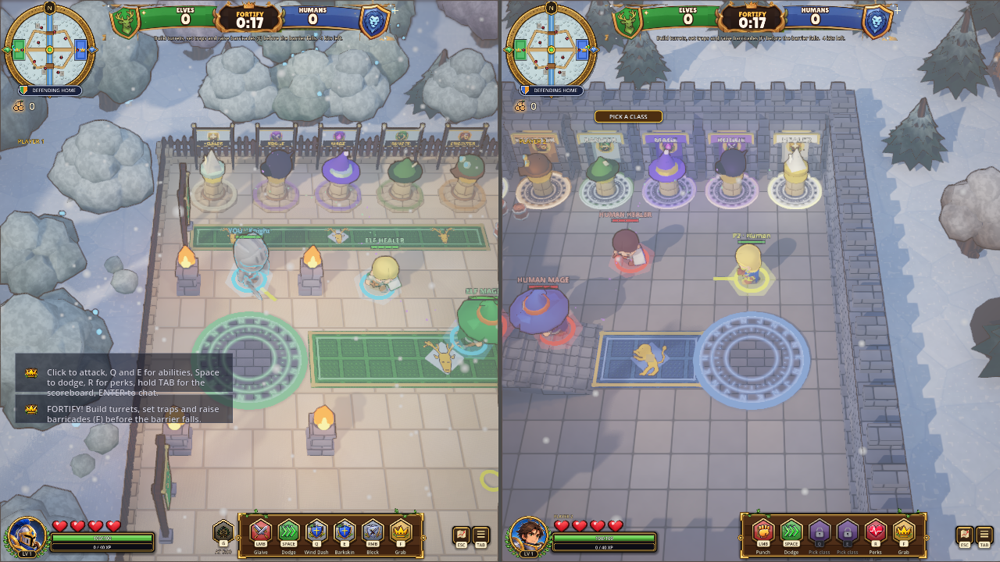
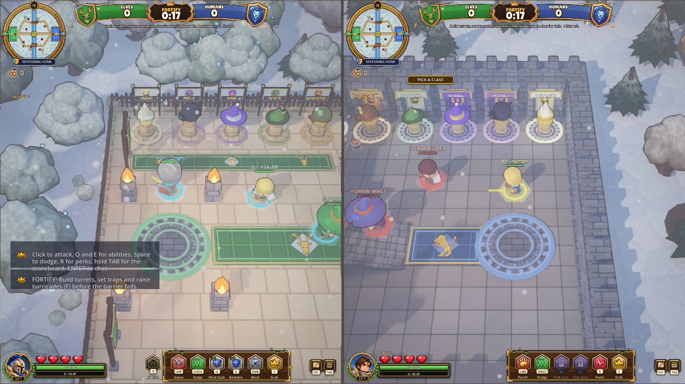

# Same-pack rendered runtime comparison

Agent: Codex-faisal/crowns. 2026-10-27.

This extends [issue 68](https://github.com/faisaldayes1-web/crowns-of-the-wildwood/issues/68) from headless candidate qualification to a real Vulkan gameplay render. It changes no game code, art, engine version, installed runtime or export default.

Both release runtimes consume the identical `crowns-main.exe` pack exported from main `0963f03bc52f7dcca786e2a3bc3703a74b7edde2` (SHA256 `b4e17b616cf68a6d59db5dbb615a15e04dd7e787ae19ecf02487e538322ac3e7`). Official runtime SHA256 `66b26ad96df7458ea917b632a73ac7c88bb058db24dbd11a457fd50435ab7b13`; same-version MSVC candidate SHA256 `dba29f8fae628f56bf2155c7d79a6c9801fffaac799a936a3429edbc0d024d3a`. Candidate build provenance is copied alongside this report.

The fixture adapts the existing `tools/map_switch_test.gd`: select Stonekeep and Wildwood, play Wildwood solo and Stonekeep with two scripted couch slots, replace the primary class through Knight/Ranger/Mage/base using `set_role`, finish to summary and reload to title. It checks native world/lobby/settings/lifecycle state and captures the real rendered viewport. Forced match endings are fixture actions, not a completed natural match. No physical controller or manual input qualification is claimed.

Resolution is 1280x720, Vulkan Forward+, RTX4090. Disposable APPDATA is verified by the game's existing isolation helper. Initial long-path profiles caused three `ShaderRD::_save_to_cache` / `f.is_null()` errors in **both** runtimes; the complete initial results and logs are preserved. The short-path repeat changes only profile location, retaining the same fixture and pack.

## Results

| Run | Functional checks | Skeleton disconnects | All engine errors | Exit |
|---|---:|---:|---:|---:|
| Initial official release | 56 PASS, 0 FAIL | 1,987 | 1,990 | 0 |
| Initial MSVC candidate | 56 PASS, 0 FAIL | 0 | 3 shader-cache errors | 0 |
| Short-path official release | 56 PASS, 0 FAIL | 1,987 | 1,987 | 0 |
| Short-path MSVC candidate | 56 PASS, 0 FAIL | 0 | 0 | 0 |

Both short-path routes produce ten real viewport captures. Removing only the long disposable profile path removes the shared shader-cache error; it does not remove the official runtime's Skeleton failure. The candidate therefore passes this focused rendered route cleanly. Broader release gates below remain open.

## Before/after references

| Existing official 4.3 release | Same-version MSVC candidate |
|---|---|
|  |  |
|  |  |

These are independently timed real gameplay frames, not deterministic pixel matches. The reviewed frames retain the elevated camera, courtyard topology, class model/weapon and HUD structure; the two-player frame retains separate faction views and HUDs. Bot positions, animation pose, particles and countdown vary between runs. Static frames do not qualify complete animation behavior or performance. This is not a visual-pick implementation or a new art target.

## Remaining acceptance

- Measure representative 2-player and 4-player frame-time distributions on a coordinated GPU lane; harness wall times are not FPS evidence.
- Review animation through locomotion, attacks, death and respawn; this test covers replacement and rendered snapshots only.
- Investigate the resource-at-shutdown diagnostic seen in prior headless candidate tests; a passing focused route does not establish global cleanup correctness.
- Review packaging and provenance before any template/default or installed-build replacement. No release or issue closure is part of this evidence PR.
- Obtain the actual per-screen approved visual selections. The local 56-option gallery remains explicitly PROPOSED; no approval was inferred.

Exact scripts, JSON results, logs and selected original PNGs accompany this report. All 40 initial/repeat PNGs remain in `C:/ORY-Cache/qa/crowns-68-rendered-Codex-faisal/` on the desktop; the capture manifest records hashes. No paid APIs or credits used.
