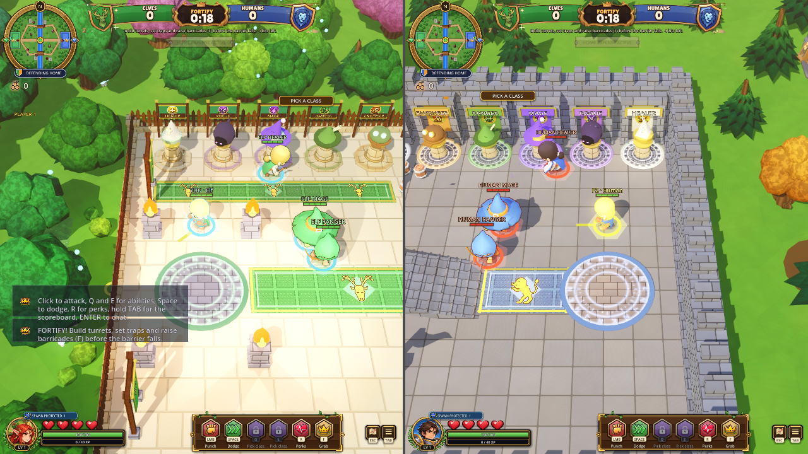
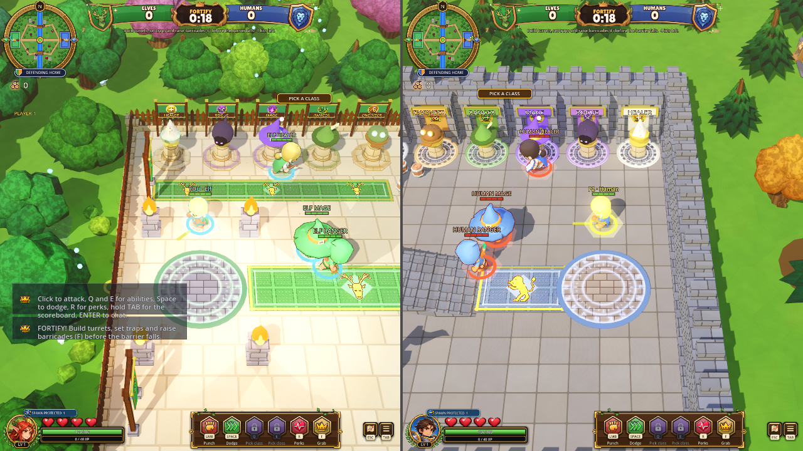

# Built-game comparison
Agent: Codex-faisal

| Current-game reference (single seat, earlier capture) | Before exported pack (two seats) | After exported pack (two seats) |
|---|---|---|
|  |  |  |

This is a sound fix. The screenshots preserve the actual camera, castle spawn locations and HUD; they are not evidence that sound is audible. Both captures use the official Godot 4.3 debug template, matching exported packs and the OpenGL compatibility renderer at 1280x720. No physical input or performance claim. Bot positions and phase timer differ slightly because live simulation advanced during loading.

The final native audio-bus capture demonstrates the behavioral change: both seats are 171.0168 m apart; player 1 and player 2 impacts each measure peak 0 before and 0.501703 after. Far-away and muted events remain 0. Solo playback measures 0.501703 in both builds, and switching back to couch restores audio only in the fixed build. The UI control measures 0.410389 in both. See control-audio-results.json and the assertion-bearing pack_audio_signal_control.gd fixture. Four-seat/lifecycle regression and a completed bot match support the scoped behavior. A physical listening pass remains outstanding; longer sounds retain emission-time positional remapping.

Earlier audio-before/after.png, pack-audio and render-audio logs plus audio-builds.json record the superseded voice-allocation-only implementation. They are retained as diagnostic history, not final acceptance. Final packs are identified by signal-audio-builds.json and signal captures above. Review caught that allocated voices alone did not prove audio reached the mixer; the PR returned to draft until this was corrected. The current reference file was a JPEG with a .png suffix; its extension is now accurate, with image bytes unchanged.

Visual gaps inherited unchanged: dense floating class names, small split-screen text, overlapping chat/tutorial hints, simplistic lighting/materials. New Crowns Style Picks are separate proposed work, not an approved target applied by this PR. The reference above is current game art, not a claimed new approved design.
