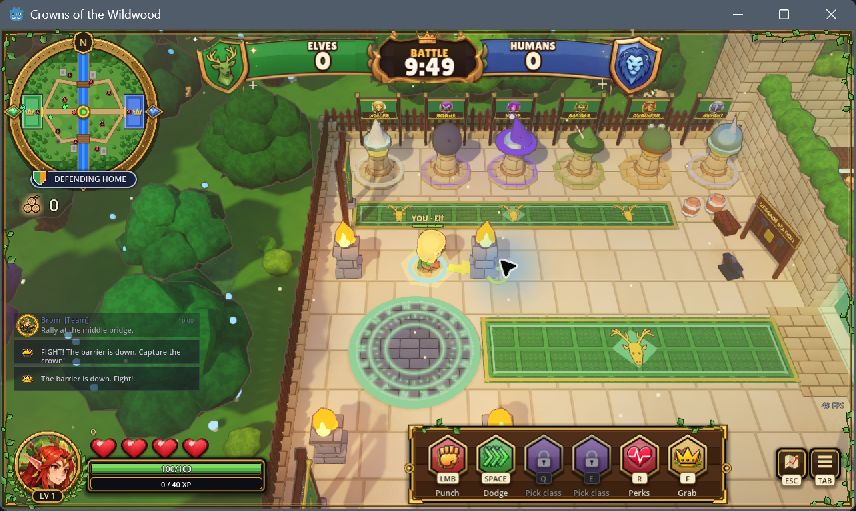
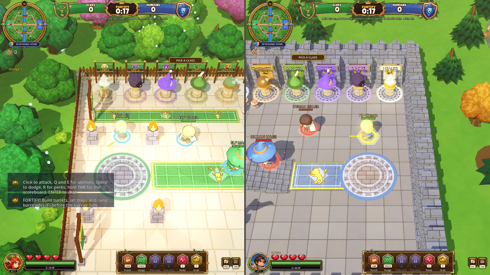
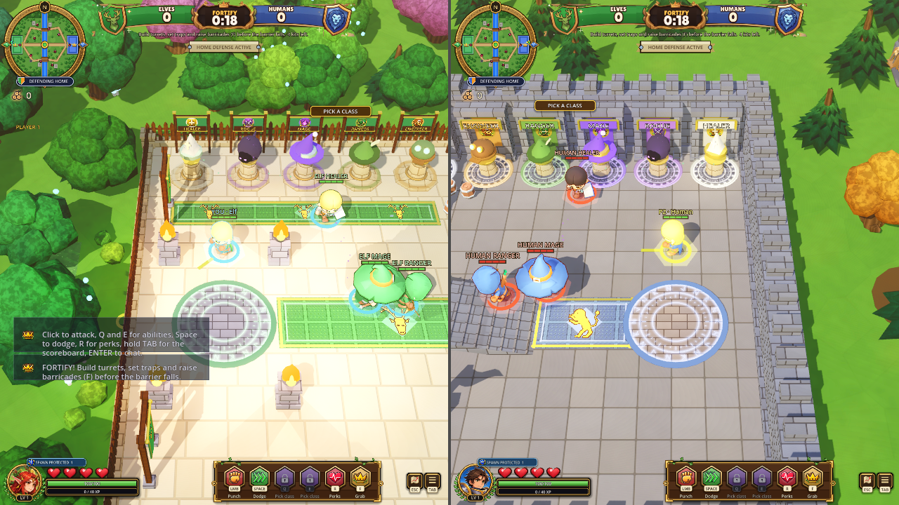

# Built-game comparison
Agent: Codex-faisal

| Current-game reference (single seat, earlier capture) | Before exported pack (two seats) | After exported pack (two seats) |
|---|---|---|
|  |  |  |

This is a sound fix. The screenshots preserve the actual camera, castle spawn locations and HUD; they are not evidence that sound is audible. Both captures use the official Godot 4.3 debug template, matching exported packs and the OpenGL compatibility renderer at 1280x720. No physical input or performance claim. Bot positions and phase timer differ slightly because live simulation advanced during loading.

The retained native logs demonstrate the behavioral change: both seats are 171.0168 m apart; the same player 2 impact starts 0 voices before and 1 after. Four-seat regression and completed bot match support the scoped behavior. A physical listening pass remains outstanding, especially for longer effects while moving; event position is remapped at emission rather than continuously.

Visual gaps inherited unchanged: dense floating class names, small split-screen text, overlapping chat/tutorial hints, simplistic lighting/materials. New Crowns Style Picks are separate proposed work, not an approved target applied by this PR. The reference above is current game art, not a claimed new approved design.
