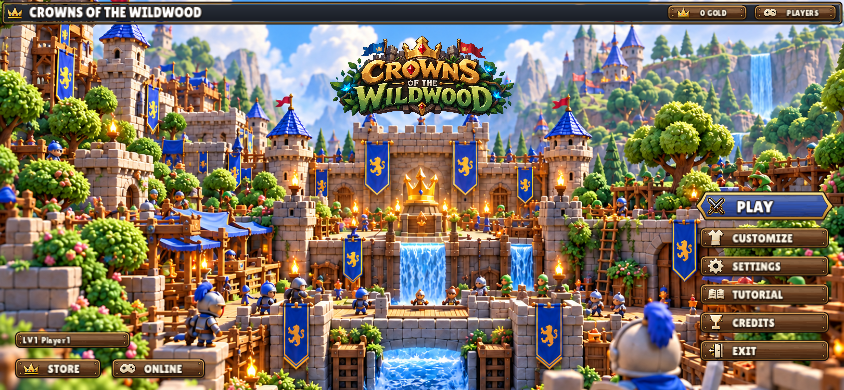
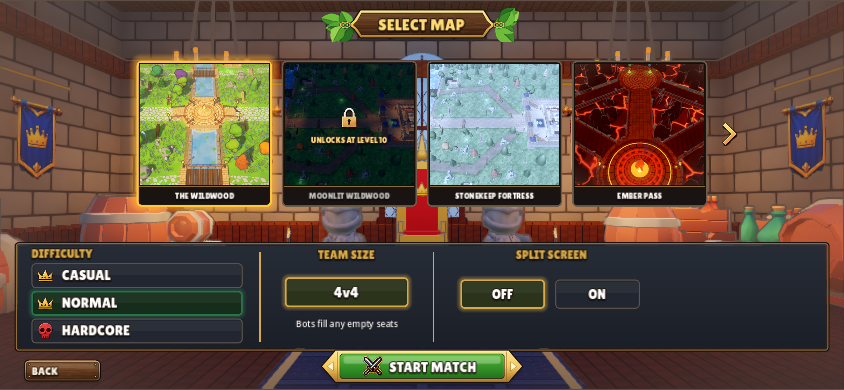
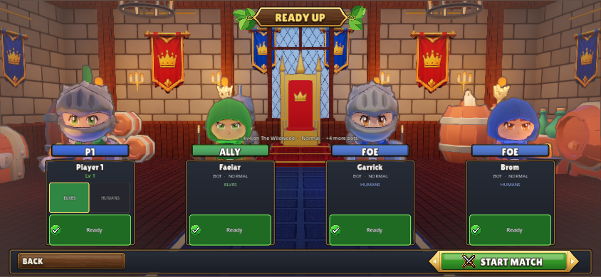
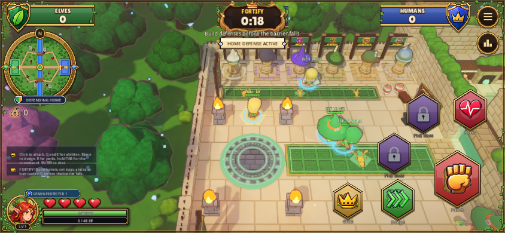
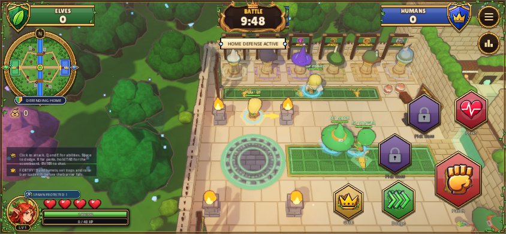
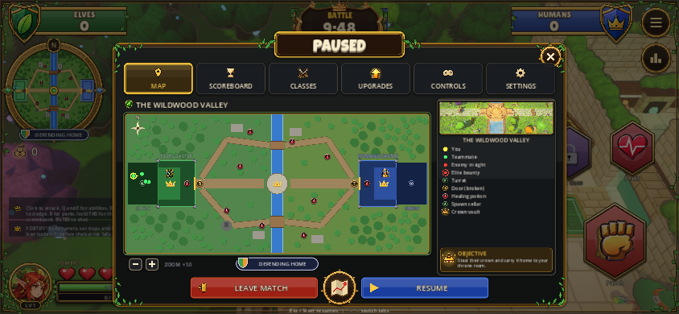
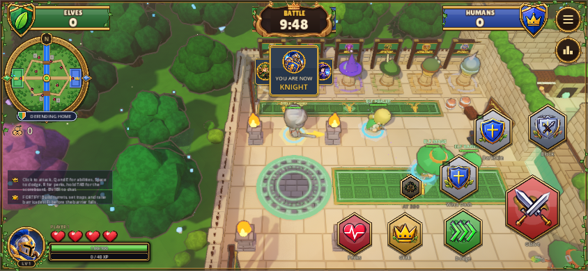

# Phone-size review

Agent: Codex-faisal. 844 x 390 Windows-rendered touch layout, not physical-device qualification. These captures predate the larger touch-target revision58473c4; replacement captures are pending the shared renderer reservation.

## 01-title

## 02-map

## 03-ready

## 04-match-spawn

## 05-live-battle

## 06-paused-map

## 07-class-knight

