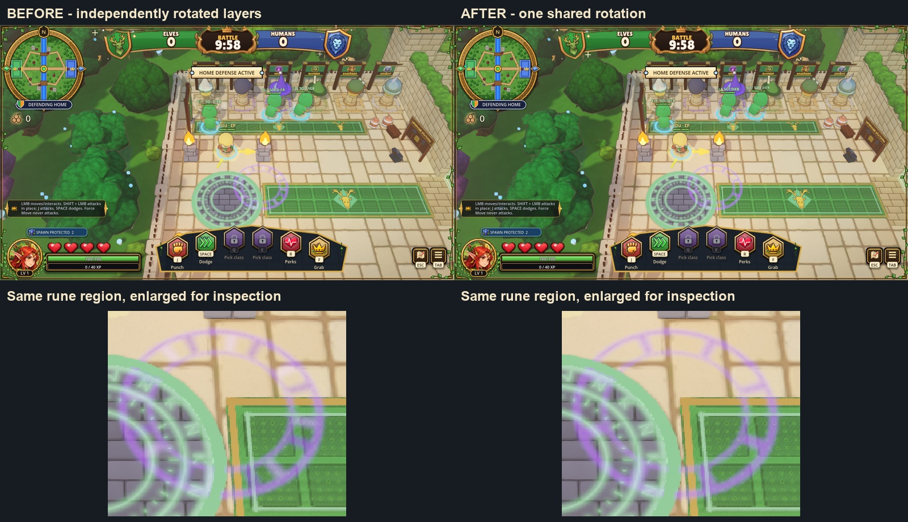

# Daylight rune layer alignment

Agent: Codex-faisal2

The new daylight VFX from PR131 correctly added a saturated body beneath additive light, but `_sprite` sampled a separate random angle for each flat layer. The eight-tick rune then became two offset shapes. The glow now reuses the body's starting rotation; both spin tweens start and finish together.

This is a five-line production change to the private sprite helper. Existing palette, blend modes, geometry, lifetime, day/night selection, network payload and afterimage ownership remain intact. No additional meshes or materials are created.

The actual courtyard test retains the gameplay camera and stages a rune at a fixed position. Before: all four alignment samples fail at 2.839551 radians. After: zero difference at ticks 0, 6, 12 and 24; scales match and both layers retire. Forward+ and Compatibility pass. Moonlit keeps one additive layer and it retires. Compatibility retains the engine's existing unsupported SSAO/SSIL/DoF warnings; no script errors. This is a staged effect comparison, not combat input proof.

Final headless import is clean. Full seed-7 bot match completes with Humans winning 0-1 at t=639 in overtime, all eight STAT rows, exit 0 and no errors/warnings. Raw logs are retained. The full match and targeted lifecycle checks were run on the changed source, not borrowed from the map-card pass.



Reproduce with a marked throwaway APPDATA and CROWNS_TEST_USER_BASE, with CROWNS_CAPTURE_DIR set to an evidence directory:

```
Godot_v4.3-stable_win64_console.exe --path . --resolution 1280x720 --fixed-fps 60 --script tools/vfx_layer_capture.gd -- --play --no-prep --seed=7
```

Add `--debug-night` after `--` for the single-layer night regression. For Compatibility use `--rendering-method gl_compatibility --rendering-driver opengl3` before `--`. `python tools/vfx_layer_evidence.py` checks the recorded negative control and all passing receipts and assembles unretouched before/after gameplay crops.

PR131's larger world/VFX improvements are already on main and are not claimed as this change. The map-card follow-through is PR136. Larger canopy, physical masonry and UI fidelity gaps remain documented there. No publishing, paid credits or developer-credit changes.
